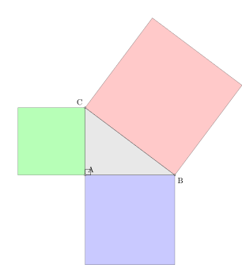
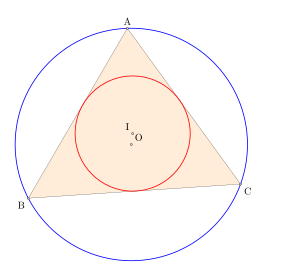
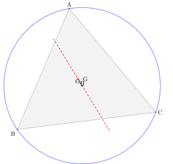

# geometry-diagram-generator

Generate geometric diagrams as SVGs from natural language using an LLM pipeline. The LLM describes geometry in a structured intermediate representation (IR); SymPy does the math; TikZ/LaTeX renders the result.

## Examples

<table>
<tr>
<td align="center"><br/>Pythagorean theorem</td>
<td align="center"><br/>Circumscribed circle</td>
<td align="center"><br/>Euler line</td>
</tr>
</table>

## How it works

```
User request
  → LLM (strategy)
  → DiagramIR (Pydantic schema)
  → SymPy geometry objects       ← source of truth for coordinates
  → Geometric validation
  → TikZ code
  → lualatex (with tkz-euclide) + dvisvgm (Docker)
  → SVG
```

The LLM avoids picking coordinates directly. It describes *what* to construct (midpoints, intersections, circumcenters, etc.); the compiler resolves positions from SymPy.

## Strategies

| Strategy | Description |
|---|---|
| `recipe` | Uses predefined YAML templates for common constructions — the main strategy to use |
| `structured` | Full IR pipeline — LLM outputs DiagramIR JSON directly |
| `python_full` | LLM writes a plain Python construction script against the pydsl builder API |
| `raw_code` | LLM generates TikZ directly |
| `raw_code_with_revise` | Raw TikZ with a revision loop on failure |
| `raw_svg` | LLM generates SVG directly |
| `raw_svg_with_revise` | Raw SVG with a revision loop on failure |

The demo server (`main.py`) reads the strategy from `GEOMETRY_STRATEGY` (fallback `STRATEGY`, default `raw_code`) and the rendering backend from `GEOMETRY_RENDERER` (fallback `RENDERER`; `svg` or `tikz`, default `svg`). The library (`GeometryConfig.from_env()`) reads `GEOMETRY_STRATEGY` (default `recipe`) and `GEOMETRY_RENDERER` (falling back to `RENDERER`, default `tikz`); see [geometry_diagrams/VENDORING.md](geometry_diagrams/VENDORING.md) for every variable.

## Quick start

**Prerequisites:** Python 3.11+, [uv](https://github.com/astral-sh/uv), Docker, Node.js + pnpm

```bash
# 1. Install dependencies (core + the dev group: tests, OpenAI/Google providers, server)
uv sync
#    Without the dev group, pick extras: `uv sync --extra server` (main.py, eval viewer),
#    `--extra openai`, `--extra google`, `--extra paper` (paper/ scripts)

# 2. Set API keys
# Create a .env with ANTHROPIC_API_KEY (and OPENAI_API_KEY / GOOGLE_API_KEY as needed)

# 3. (Optional) Build and start the TikZ renderer container — only needed for RENDERER=tikz;
#    the default RENDERER=svg renders in-process, no Docker required.
#    Build from the project root (the image copies the bundled fonts). The container runs
#    lualatex with --no-shell-escape as a non-root user and caps request sizes; after
#    rebuilding, check that a render still works.
docker build -f renderer/Dockerfile -t tikz-renderer .
docker run -p 127.0.0.1:8001:8001 tikz-renderer   # see CLAUDE.md for a locked-down run; untrusted TikZ can read files inside the container

# 4. Start the server
uv run python -m uvicorn main:app

# 5. Start the UI
cd demo-ui && pnpm install && pnpm dev
# Open http://localhost:5173
```

## Development

```bash
# Run tests (300 s per-test timeout; `renderer`-marked tests need the container, `llm`-marked tests need RUN_LLM_TESTS=true and an API key)
uv run python -m pytest tests/

# Run evals (--scenarios defaults to evals/scenarios_core.yaml; --renderer defaults to tikz and needs the
# renderer container, add `--renderer svg` to run without it)
uv run python -m evals.run \
  --scenarios evals/scenarios.yaml \
  --strategies structured \
  --model anthropic:claude-sonnet-4-6 \
  --repeats 3 \
  --output evals/results

# Start eval viewer
uv run python evals/eval_viewer.py   # backend on 127.0.0.1:8002
cd eval-viewer-ui && pnpm dev        # frontend proxies /api to :8002
```

## Project layout

```
geometry_diagrams/        Core package (also the unit copied into other projects)
  ir/                        Intermediate representation: schema, SymPy compiler, TikZ/SVG emitters, checks
  strategies/                LLM strategy implementations
  recipe/                    Declarative DSL + YAML templates for common constructions
  pydsl/                     Python-native DSL: builder-shim API + sandboxed script execution
  util/                      Shared utilities (renderer client, SVG/TikZ checks, LLM judge)
renderer/                  Docker container: FastAPI server wrapping lualatex + dvisvgm
evals/                     Benchmark harness, scenarios, result viewer
demo-ui/                   Vite frontend (served from / by main.py once built)
eval-viewer-ui/            Vite frontend for browsing eval results
docs/                      DSL specification (geometry-dsl-spec.md), strategy diagrams, dataset datasheet, eval reports, study protocols, specs, and rendered examples
curriculum/                Scripts that extract textbook curriculum structure and generate student-style prompts
benchmark/                 Benchmark data attribution (Bluebonnet Learning textbook-derived material)
paper/                     LaTeX source of the GeoGenBench paper
slides/                    Onboarding presentations
tests/                     Unit and integration tests
```

## Architecture notes

- See [CLAUDE.md](CLAUDE.md) for the full pipeline description and design rationale.
- See [docs/geometry-dsl-spec.md](docs/geometry-dsl-spec.md) for the IR schema specification.
- The renderer container exposes `POST /render` (TikZ → SVG) and `GET /health` on port 8001.
- **LangGraph** and **LangChain** are used for LLM agent orchestration, with Anthropic, OpenAI, and Google backends.
